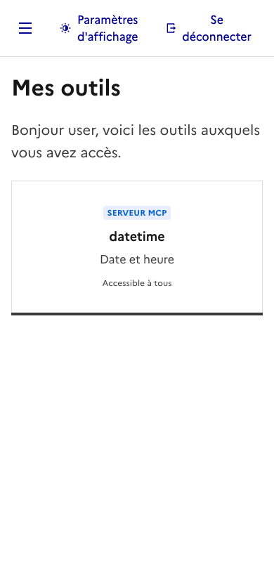
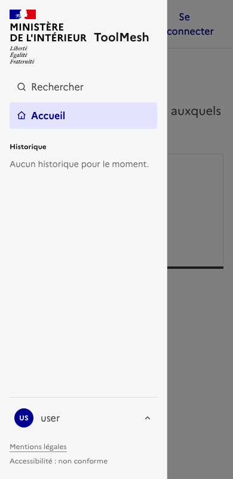
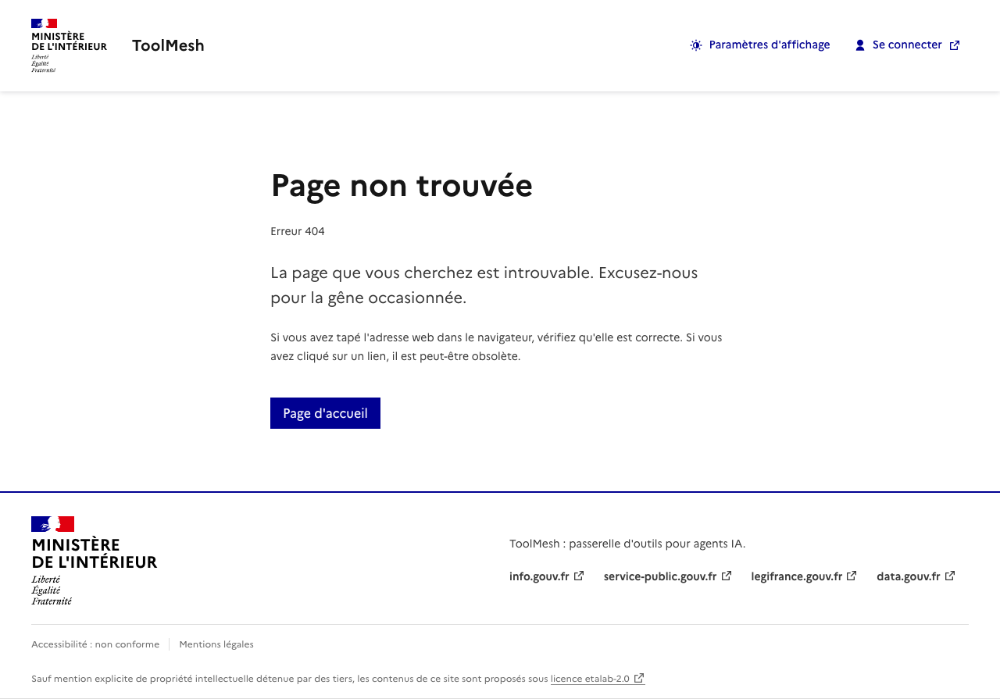
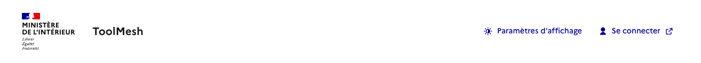
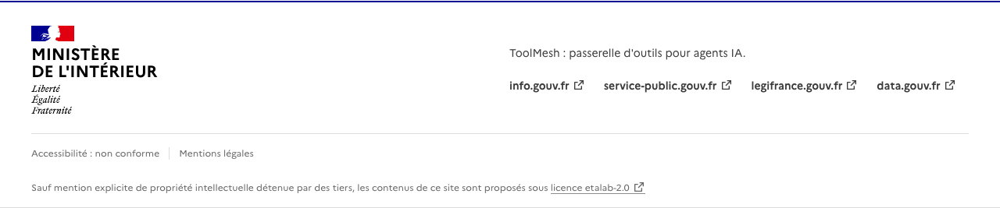
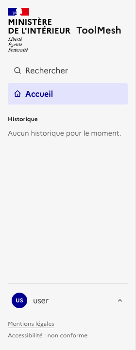
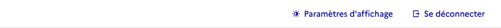
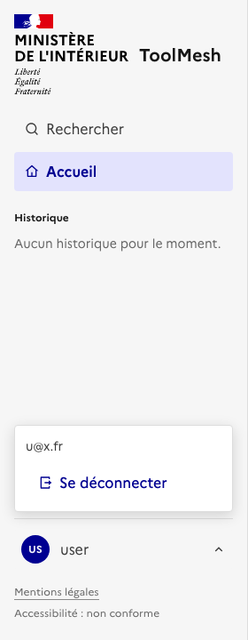
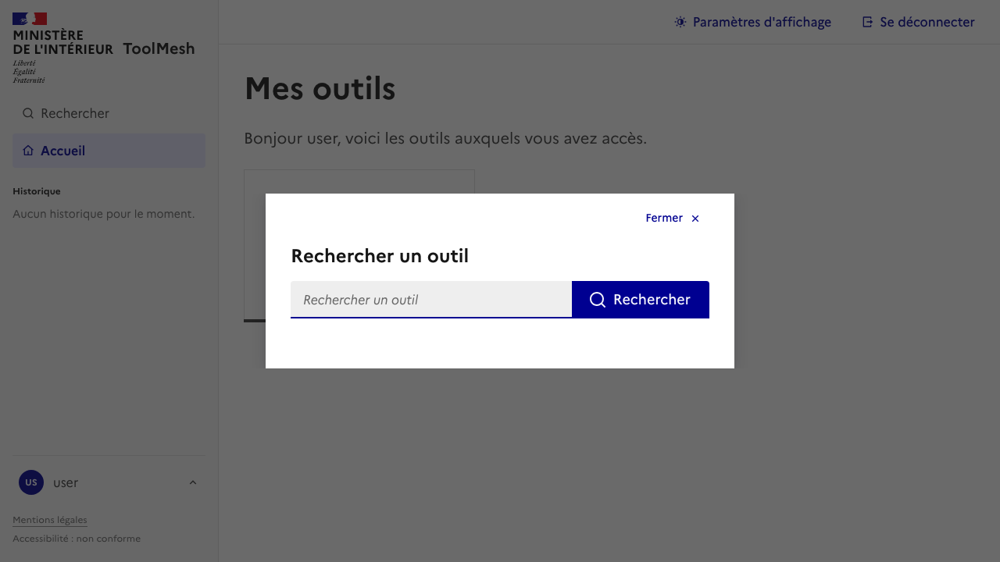
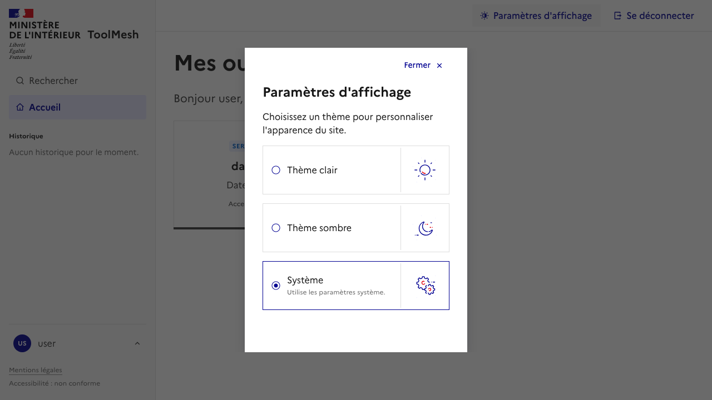

# Captures du frontend

Générées par `cd frontend && bun run docs:screenshots`.

| Page / composant        | Capture                                   |
| ----------------------- | ----------------------------------------- |
| Landing (anonyme)       |             |
| Accueil (connecté)      |            |
| Accueil (erreur)        |       |
| Accueil (mobile)        |              |
| Accueil (menu mobile)   |         |
| Mentions légales        |       |
| Page 404                |                    |
| Header (anonyme)        |         |
| Footer                  |          |
| Barre latérale          |       |
| Mini header             |        |
| Menu du compte (ouvert) |       |
| Modale de recherche     |   |
| Paramètres d'affichage  |  |
